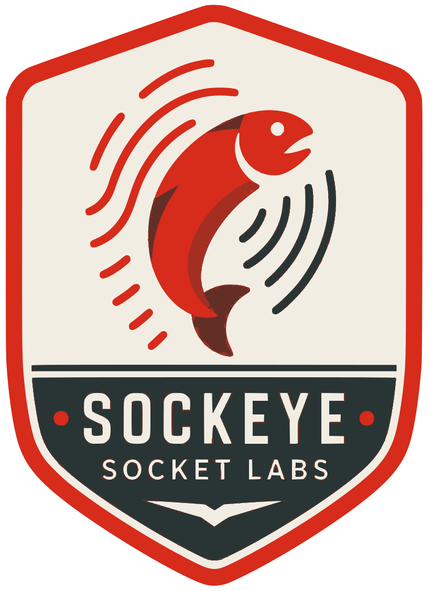

# Sockeye

<div align="center">
  
</div>

[](https://twitter.com/SocketSecurity)
[](https://bsky.app/profile/socket.dev)

Touch-gated local credentials for developer tools and automation.

Developer tools sometimes need credentials that should never appear in a
command line, environment file, chat transcript, or agent context. Sockeye
stores those credentials in macOS Keychain and gives them only to one exact
child process after a human approves the request with Touch ID.

Sockeye does not have a plaintext `get` command or a background unlock daemon.
Read [the security model](docs/security-model.md) before integrating it with a
tool.

The name comes from the Halkomelem word _sθə́qəy_, meaning “red fish.” English
adapted the word as “sockeye.” See the
[Dictionary of Canadianisms on Historical Principles](https://dchp.arts.ubc.ca/entries/sockeye)
for the language history.

## Install

Sockeye is pre-release and macOS-only. Build the current development binary
from a reviewed checkout:

```sh
pnpm install
pnpm run build
```

The binary is written to
`build/dev/<platform>-<architecture>/out/Final/sockeye`. A signed GitHub release
and checksum-verified installer remain release gates; see the
[release checklist](docs/release-checklist.md).

## Usage

Store a credential from an attached terminal. Sockeye hides the input; press
Control-D when the value is complete.

```sh
sockeye set SOCKET_RELEASE_CLIENT_ID
```

For a guided Keychain or one-time 1Password import, use
[`pnpm run setup:credential`](docs/credential-setup.md). The setup command
never makes 1Password a runtime credential provider.

Run one child with an exact credential list, working directory, executable,
arguments, and optional bound files:

```sh
sockeye run \
  --credential SOCKET_RELEASE_APP_PRIVATE_KEY \
  --pass-env SOCKET_RELEASE_CLIENT_ID \
  --bind-file /absolute/path/to/runner.mjs \
  --cwd /absolute/path/to/repository \
  -- /absolute/path/to/node /absolute/path/to/runner.mjs
```

Sockeye prints the complete request and a manifest digest before showing the
Touch ID prompt. The child receives a minimal environment containing only the
listed credentials and any names explicitly added with `--pass-env`. For
`ENVRYPT_PRIVATE_KEY`, Sockeye uses Envrypt's one-use `envrypt-v1` pipe instead
of putting the key in that environment.

`SOCKET_RELEASE_CLIENT_ID` is public configuration, so the example passes it
from the parent environment. The private key is a secret and comes from
Keychain. Keeping that distinction explicit avoids unnecessary biometric
storage for values that are safe to display.

### Agent-CI

The repository bridge derives the exact `secrets.NAME` and `vars.NAME`
references from one selected workflow. It asks Sockeye for only those secret
names and converts public variables into Agent-CI's `--var` arguments:

```sh
SOCKET_RELEASE_CLIENT_ID=<public-id> pnpm run ci:sockeye -- \
  run --workflow .github/workflows/github-release.yml \
  --quiet --pause-on-failure --github-token
```

The bridge refuses `--all` because a multi-workflow run would widen the
credential request. It also refuses generated gh-aw `.lock.yml` files, which
Agent-CI cannot execute. The bridge process never reads a secret value; it sees
only secret names and public variable values. The Touch ID approval still
happens once, immediately before the exact Agent-CI child launch.

## Development

<details>
<summary>Contributor commands</summary>

```sh
pnpm install
pnpm run build
pnpm run test
pnpm run check
```

Vitest is the test orchestrator even though the product is C++. Read
[native development and testing](docs/native-development.md) for the file
layout and test boundaries.

</details>

## License

MIT

<br/>
<div align="center">
  <picture>
    <source media="(prefers-color-scheme: dark)" srcset="assets/fleet/socket-combomark-dark.svg">
    <source media="(prefers-color-scheme: light)" srcset="assets/fleet/socket-combomark-light.svg">
    
  </picture>
</div>
